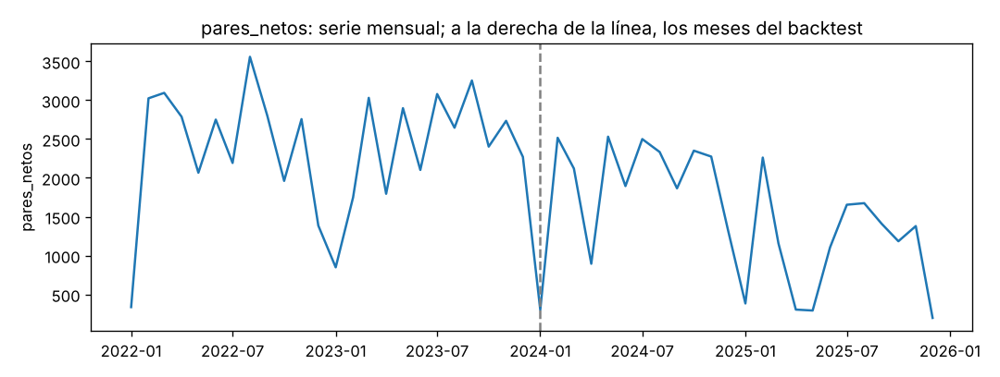
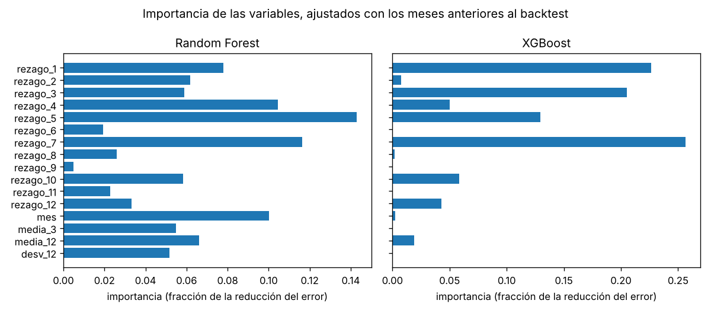
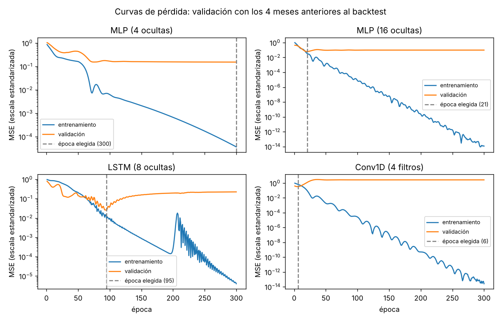
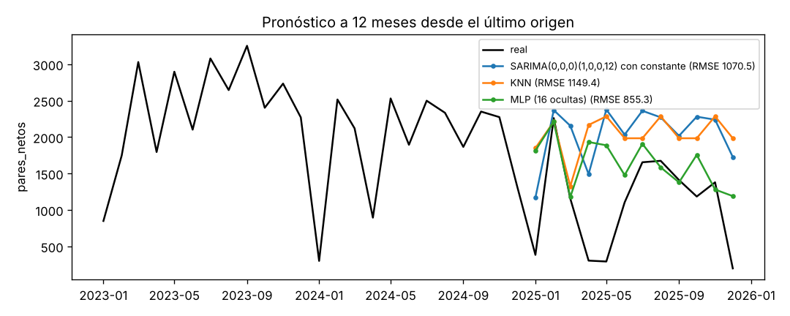
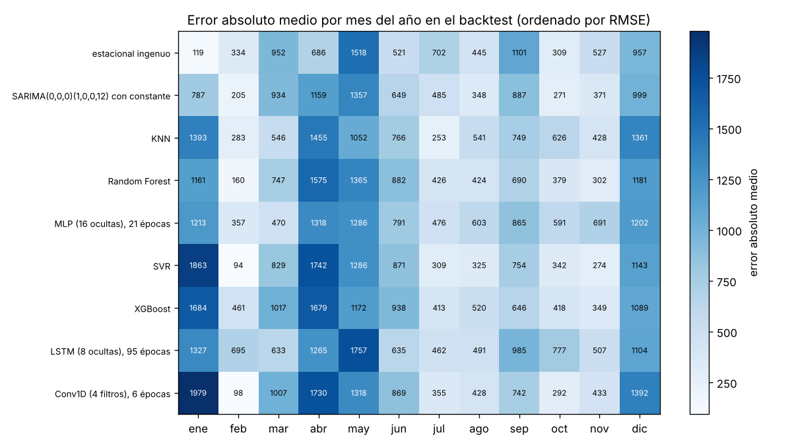

# Informe del miniproyecto 2

**Grupo:** Mónica Giraldo (22507481), Edison Orozco (22601596) y Armando
Betancourt (22507271).

Todas las cifras de este informe salen de lo que imprime
`python miniproyecto.py` y de las tablas que deja en `resultados/`; las
figuras son las que el mismo guion deja en `figuras/`. El guion es
determinista (semillas fijas): al volver a correrlo solo cambian, en décimas,
los segundos de la columna `segundos`; las tablas de este informe son las de
la corrida que dejó `resultados/metricas.csv`. Corre completo en unos 20 s en
CPU, muy por debajo de los 10 minutos de la acción de GitHub.

## 1. La serie y el modelo a superar

La serie es la del miniproyecto 1: **pares netos de calzado vendidos por
mes** por una empresa colombiana (datos agregados y anonimizados, ficha en
`datos/README.md`), de enero de 2022 a diciembre de 2025, **48
observaciones**. La preparación es la misma del miniproyecto 1 y la función
`preparar` se copió sin cambios: no hay meses sin dato, así que no se imputa
nada; el criterio IQR (límites $[-585.9,\ 4619.1]$) no marca ningún mes y se
conservan todos los valores, incluidos los meses bajos de 2025, porque no hay
soporte comercial para corregirlos.

Lo que domina el *backtest* es una **caída de nivel**: el guion imprime
28 708 pares en 2022, 28 803 en 2023, 22 902 en 2024 y 12 998 en 2025. Los 24
meses del *backtest* (2024 y 2025) son justo los de la caída; 2025 vendió el
45 % de 2023 ($12\,998/28\,803$).

**El modelo a superar.** En el miniproyecto 1 los órdenes salieron de una
rejilla por AIC con los 24 meses anteriores al primer origen y el ganador fue
un SARIMA$(0,0,0)(1,0,0)_{12}$ con constante, sin transformación y sin
exógenas (el SARIMAX con festivos de Colombia dio RMSE 885.71 y quedó peor):

$$
(1-\Phi B^{12})\,(y_t-\mu)=\varepsilon_t
\quad\Longleftrightarrow\quad
y_t = c + \Phi\,y_{t-12} + \varepsilon_t,\qquad c=\mu(1-\Phi),\ \ \varepsilon_t\sim\mathcal N(0,\sigma^2).
$$

Ajusta tres números ($c$, $\Phi$ y $\sigma^2$) y se reestima en cada origen
con el mismo código del miniproyecto 1 (`ARIMA` de statsmodels, escala de
trabajo en decenas de pares). Las métricas son las del *backtest* común:

$$
\mathrm{RMSE}=\sqrt{\tfrac1h\textstyle\sum_{k=1}^{h}(y_{T+k}-\hat y_{T+k})^2},\quad
\mathrm{MAE}=\tfrac1h\textstyle\sum_{k=1}^{h}|y_{T+k}-\hat y_{T+k}|,\quad
\mathrm{MAPE}=\tfrac{100}{h}\textstyle\sum_{k=1}^{h}\left|\tfrac{y_{T+k}-\hat y_{T+k}}{y_{T+k}}\right|,
$$

con $h=12$, promediadas sobre los 13 orígenes (diciembre de 2023 a diciembre
de 2024).

| Modelo | RMSE | MAE | MAPE (%) | Miniproyecto 1 |
|---|---|---|---|---|
| SARIMA(0,0,0)(1,0,0,12) con constante | 851.25 | 704.41 | 114.01 | 851.25 / 704.41 / 114.01 |
| estacional ingenuo (piso) | 842.94 | 680.98 | 90.89 | 842.94 / 680.98 / 90.89 |

**Las métricas coinciden exactamente con las del miniproyecto 1**: no se
cambió nada al trasladar el modelo. Como ya se vio entonces, el estacional
ingenuo, $\hat y_{T+k}=y_{T+k-12}$, le gana por 8.31 pares de RMSE. El MAPE es
alto en todos los modelos porque hay meses con muy pocos pares (197 en
diciembre de 2025, 292 en mayo de 2025): un error de unos cientos de pares en
esos meses vale más del 100 %. Por eso las comparaciones de este informe se
hacen con el RMSE.

## 2. La tabla supervisada

Cada mes $t$ es una fila con 16 columnas, todas calculadas solo con meses
anteriores a $t$ (la columna objetivo es $z_t$):

| Columnas | Fórmula | Qué aporta |
|---|---|---|
| `rezago_1` … `rezago_12` | $z_{t-k},\ k=1,\dots,12$ | la memoria reciente y el mismo mes del año anterior (rezago 12) |
| `mes` | $\mathrm{mes}(t)\in\{1,\dots,12\}$ | el calendario, que se conoce de antemano |
| `media_3` | $\frac13\sum_{j=1}^{3} z_{t-j}$ | el nivel del último trimestre |
| `media_12` | $\bar z_t^{(12)}=\frac1{12}\sum_{j=1}^{12} z_{t-j}$ | el nivel del último año |
| `desv_12` | $\sqrt{\frac1{11}\sum_{j=1}^{12}\big(z_{t-j}-\bar z_t^{(12)}\big)^2}$ | la volatilidad del último año |

En el código los rezagos son `z.shift(k)` y las ventanas se calculan sobre
`z.shift(1)`, es decir, sobre la serie ya corrida un mes.

**Qué aprenden los modelos: `OBJETIVO = "nivel"`**, $z_t=y_t$. La diferencia
estacional $z_t=y_t-y_{t-12}$ sería la elección natural para quitar el
patrón anual, pero con 48 meses no cabe: la diferencia se come los primeros
12 meses y los 12 rezagos otros 12. El guion lo imprime: con `dif12` la tabla
tiene **0 filas en el primer origen** y 12 en el último; con `nivel`, 12 y 24.
Sin filas en los primeros orígenes no hay modelo que entrenar. El precio de
aprender el nivel también queda medido: un árbol no puede pronosticar por
debajo del mínimo que vio, y **4 de los 24 meses del *backtest* quedan por
debajo del mínimo anterior (336 pares)** (enero de 2024 y abril, mayo y
diciembre de 2025).

**Prueba de que ninguna fila ve el mes que predice** (`comprobar_sin_fuga`).
Para cada uno de los 48 meses, el guion altera $y_t$ (lo cambia por
$10\,y_t+1000$), rehace la tabla completa y exige con `np.allclose` que la
fila $t$ quede idéntica; si alguna cambiara, lanza `AssertionError` y el
guion se detiene. Como control, cuenta en cuántos casos la alteración sí
llega a filas posteriores, para comprobar que la prueba no es vacía. Imprime:

> sin fuga: se alteró cada uno de los 48 meses y ninguna fila cambió en su
> propio mes; la alteración sí cambió filas posteriores en 47 casos

(el caso que falta es el último mes, que no tiene filas posteriores).

**Pronóstico recursivo a 12 meses** (`recursivo`). Desde el origen $T$, para
$k=1,\dots,12$: se agrega el mes $T+k$ con valor vacío, se arma su fila, que
solo usa meses anteriores, se pronostica $\hat z_{T+k}$, se lleva al nivel
($\hat y_{T+k}=\hat z_{T+k}$ con `nivel`; sería $y_{T+k-12}+\hat z_{T+k}$ con
`dif12`) y ese valor se escribe en la serie como si fuera dato. Así, en el
paso siguiente, $\hat y_{T+k}$ entra como `rezago_1` y en las medias móviles:

$$
\hat y_{T+k}=f\big(\hat y_{T+k-1},\dots,\hat y_{T+1},\,y_T,\dots,y_{T+k-12},\ \mathrm{mes}(T+k),\dots\big).
$$

**Escaladores.** Todos se ajustan dentro de `fit`, y `fit` se llama en cada
origen con la tabla del entrenamiento de ese origen (`con_tabla`): el
`StandardScaler` de KNN y SVR va dentro del *pipeline*; el SVR escala además
el objetivo con un `TransformedTargetRegressor`, porque su $\varepsilon$ está
en las unidades del objetivo; y la clase `Red` estandariza la entrada y la
salida, $\tilde x=(x-\bar x_{\text{ent}})/s_{\text{ent}}$, con la media y la
desviación del entrenamiento del origen. Ningún escalador ve un mes posterior
al origen.

## 3. Aprendizaje automático

**Con qué datos se eligen los hiperparámetros.** Solo con los 24 meses
anteriores al primer origen (2022 y 2023), que dan una tabla de **12 filas,
de 2023-01 a 2023-12**. Sobre ella, `GridSearchCV` con
`TimeSeriesSplit(n_splits=3, test_size=2)`: tres cortes que entrenan con 6, 8
y 10 filas y validan cada uno los dos meses siguientes (julio-agosto,
septiembre-octubre y noviembre-diciembre de 2023), con el RMSE a un paso como
criterio. Ningún mes de 2024 ni de 2025, que son los del *backtest*, entra en
la elección: la tabla se arma con `serie.iloc[:-N_PRUEBA]`. Las rejillas son
pequeñas y pensadas para pocas filas (KNN no puede pedir más vecinos que las
6 filas del primer corte):

| Modelo | Rejilla | Elegido | RMSE de validación |
|---|---|---|---|
| KNN | $k\in\{1,2,3,5\}$ | $k=3$ | 446.14 |
| SVR (núcleo RBF) | $C\in\{0.3,1,3,10\}$, $\varepsilon\in\{0.05,0.1,0.3\}$ | $C=1$, $\varepsilon=0.3$ | 511.10 |
| Random Forest (100 árboles) | profundidad $\in\{2,3,\text{sin límite}\}$, hoja mínima $\in\{1,2,4\}$ | sin límite, 1 | 437.16 |
| XGBoost (200 árboles) | profundidad $\in\{1,2,3\}$, tasa $\in\{0.03,0.1,0.3\}$ | 2, 0.3 | 580.74 |

Con lo elegido, cada modelo se vuelve a entrenar desde cero en cada origen
del *backtest*. La validación es débil, y el informe lo dice: decide con
6 meses y una sola temporada de rezagos 12, y los RMSE de validación (437 a
581) son mucho menores que los del *backtest* (933 a 1038) porque 2023 fue
un año estable y 2024-2025 no.

**Importancia de las variables** (Random Forest y XGBoost ajustados con lo
elegido sobre las 12 filas de 2023; reducción del error que aporta cada
variable, normalizada). Random Forest reparte la importancia: sus tres
mayores son `rezago_5` (0.14), `rezago_7` (0.12) y `rezago_4` (0.10), y `mes`
le sigue con 0.10. XGBoost la concentra en `rezago_7` (0.26), `rezago_1`
(0.23) y `rezago_3` (0.21) y deja en cero varias columnas. **Coinciden solo en
parte con la PACF del miniproyecto 1**, que marcaba los rezagos 1 ($r=0.304$)
y 12 ($r=0.336$): `rezago_1` sí pesa en XGBoost, pero `rezago_12` pesa poco en
los dos (0.03 y 0.04). La razón está en las filas: con 12 filas, los 12
valores de `rezago_12` son los 12 meses de 2022, una sola temporada, y los
árboles prefieren cualquier rezago que separe por casualidad esos 12 puntos.
Que los dos ensambles elijan rezagos distintos (5 y 7 frente a 7, 1 y 3) es
otra señal de que la importancia, con tan pocas filas, es inestable.

**Los cuatro en el *backtest* común:**

| Modelo | RMSE | MAE | MAPE (%) | Parámetros | Peor mes | Sesgo |
|---|---|---|---|---|---|---|
| KNN | 932.59 | 787.81 | 125.21 | 384 | abril | +716.4 |
| Random Forest | 944.36 | 774.44 | 131.25 | 3030 | abril | +710.4 |
| SVR | 1032.94 | 819.26 | 148.84 | 290 | enero | +773.2 |
| XGBoost | 1037.86 | 865.49 | 142.94 | 1188 | enero | +754.5 |

**Gana KNN** (RMSE 932.59), seguido de cerca por Random Forest, que tiene el
menor MAE. Ninguno le gana al SARIMA (851.25) ni al estacional ingenuo
(842.94). El sesgo es el promedio de pronóstico menos real en todos los
meses del *backtest*: los cuatro sobrepronostican en unos 700 pares al mes,
porque aprendieron el nivel de 2022-2023 y la serie cayó. Sus peores meses
son enero y abril (`resultados/errores_por_mes.csv`): enero es el mes más
bajo de cada año (336, 848, 300 y 383 pares) y con 12 a 24 filas los modelos
no aprenden bien ese hundimiento anual, y abril es el mes en que 2025 se
desplomó (304 pares, frente a 894 en abril de 2024).

## 4. Aprendizaje profundo

Las tres redes se entrenan con la clase `Red` del repositorio base: Adam con
tasa 0.01, pérdida MSE sobre el objetivo estandarizado y todas las filas en
un solo lote. Son deliberadamente pequeñas, porque en el último origen la
tabla tiene 24 filas.

| Red | Arquitectura | Entrada | Parámetros |
|---|---|---|---|
| MLP | $\hat z=W_2\,\mathrm{ReLU}(W_1x+b_1)+b_2$, con 16 ocultas (se probó también 4) | las 16 columnas sueltas, estandarizadas | 289 ($16\cdot16+16+16+1$) |
| LSTM | una capa `nn.LSTM` de 8 estados ocultos; una capa lineal lee el último estado $h_{12}$ | la secuencia de rezagos $(z_{t-12},\dots,z_{t-1})$, forma (lote, 12, 1) | 361 |
| Conv1D (tercera red) | 4 filtros de ancho 3 sobre la secuencia, ReLU y una capa lineal sobre los $4\times10$ mapas | la misma secuencia que la LSTM | 57 |

La LSTM actualiza, en cada uno de los 12 pasos,
$c_s=f_s\odot c_{s-1}+i_s\odot\tanh(W_c[h_{s-1},x_s]+b_c)$ y
$h_s=o_s\odot\tanh(c_s)$, con compuertas $f_s,i_s,o_s=\sigma(W[h_{s-1},x_s]+b)$.
La Conv1D calcula $m_{f,s}=\mathrm{ReLU}\big(\sum_{j=0}^{2}w_{f,j}\,x_{s+j}+b_f\big)$
para $s=1,\dots,10$ y $\hat z=v^\top\mathrm{vec}(m)+b$.

**Por qué la Conv1D como tercera red.** Es la que menos parámetros tiene (57,
frente a 289 del MLP y 361 de la LSTM), y con 12 a 24 filas el número de
parámetros es el problema principal. Además, sus filtros comparten pesos a lo
largo de la ventana: detectan el mismo patrón local de tres meses (una subida
o una caída) en cualquier posición, que es justo lo que interesa en una serie
cuyo rasgo principal es una caída sostenida.

**Validación de épocas y tamaño.** Con la tabla de los meses anteriores al
*backtest* (12 filas): las redes entrenan con 8 (2023-01 a 2023-08) y validan
con los 4 siguientes (2023-09 a 2023-12), hasta 300 épocas; se elige la época
de menor pérdida de validación. Lectura de las curvas:

- **MLP (16 ocultas): 21 épocas.** La pérdida de validación toca su mínimo
  (0.063) en la época 21 y luego sube y se queda en 0.098, mientras la de
  entrenamiento cae hasta prácticamente cero: desde la época 21 la red
  memoriza las 8 filas. El MLP de 4 ocultas tiene su mínimo de validación
  (0.152) en la época 300, más del doble que el de 16, así que **queda el MLP
  de 16 ocultas**.
- **LSTM (8 ocultas): 95 épocas.** El mínimo de validación (0.026) está en la
  época 95; después la validación sube hasta 0.223 en la época 300 mientras
  el entrenamiento sigue bajando: el sobreajuste empieza hacia la época 100.
- **Conv1D (4 filtros): 6 épocas.** La validación es mínima (0.332) casi al
  arrancar y sube hasta 2.706; la red sobreajusta desde las primeras épocas.

Con solo 4 meses de validación las épocas elegidas son ruidosas: un mes
distinto en la validación podría mover el mínimo. Es la principal debilidad
de esta parte, y viene de la longitud de la serie.

**Las tres redes en el *backtest*:**

| Red | RMSE | MAE | MAPE (%) | Parámetros | Peor mes | Sesgo |
|---|---|---|---|---|---|---|
| MLP (16 ocultas), 21 épocas | 975.59 | 822.00 | 118.23 | 289 | abril | +695.8 |
| LSTM (8 ocultas), 95 épocas | 1087.38 | 886.48 | 141.50 | 361 | mayo | +736.5 |
| Conv1D (4 filtros), 6 épocas | 1099.95 | 886.95 | 157.20 | 57 | enero | +840.6 |

**La mejor red, el MLP, con cinco semillas** (`resultados/semillas.csv`):

| Semilla | 2026 | 2027 | 2028 | 2029 | 2030 |
|---|---|---|---|---|---|
| RMSE | 975.59 | 986.92 | 1063.75 | 1000.32 | 977.75 |

$$
\overline{\mathrm{RMSE}}=1000.87,\qquad s=\sqrt{\tfrac14\textstyle\sum_{i=1}^{5}\big(\mathrm{RMSE}_i-\overline{\mathrm{RMSE}}\big)^2}=36.48 .
$$

Solo con cambiar la semilla el RMSE va de 975.59 a 1063.75. La diferencia con
el clásico es $1000.87-851.25=149.62$, **4.1 veces la desviación entre
semillas**: es mayor que esa desviación, así que no es un efecto de la
semilla; ni la mejor de las cinco (975.59) alcanza al SARIMA.

## 5. La tabla y la elección

`resultados/metricas.csv`, tal como lo escribe el guion, ordenado por RMSE:

| Modelo | RMSE | MAE | MAPE (%) | Parámetros | Segundos |
|---|---|---|---|---|---|
| estacional ingenuo | 842.94 | 680.98 | 90.89 | 0 | 0.0 |
| SARIMA(0,0,0)(1,0,0,12) con constante | 851.25 | 704.41 | 114.01 | 3 | 0.7 |
| KNN | 932.59 | 787.81 | 125.21 | 384 | 0.8 |
| Random Forest | 944.36 | 774.44 | 131.25 | 3030 | 2.5 |
| MLP (16 ocultas), 21 épocas | 975.59 | 822.00 | 118.23 | 289 | 0.9 |
| SVR | 1032.94 | 819.26 | 148.84 | 290 | 0.8 |
| XGBoost | 1037.86 | 865.49 | 142.94 | 1188 | 1.0 |
| LSTM (8 ocultas), 95 épocas | 1087.38 | 886.48 | 141.50 | 361 | 2.2 |
| Conv1D (4 filtros), 6 épocas | 1099.95 | 886.95 | 157.20 | 57 | 0.7 |

Los parámetros son los del modelo ajustado en el último origen (36 meses, 24
filas de tabla): en el SARIMA, $c$, $\Phi$ y $\sigma^2$; en KNN, los
$24\times16=384$ valores que memoriza; en SVR, los vectores de soporte y sus
coeficientes; en los ensambles, los nodos de sus árboles; en las redes, sus
pesos.

**Ninguna red supera al clásico, y ningún modelo de aprendizaje automático
tampoco.** Lo atribuimos a dos hechos de la serie, que el guion mide:

1. **Muchos más parámetros que datos.** El SARIMA ajusta 3 números con 36
   meses. El MLP ajusta 289 pesos con 24 filas, unos 12 pesos por fila; la
   LSTM, 361 (15 por fila). Las curvas de pérdida lo muestran: la pérdida de
   entrenamiento llega prácticamente a cero, es decir, la red puede
   memorizar las filas, y la validación deja de mejorar a las 21 épocas en
   el MLP y a las 6 en la Conv1D. Con tan pocas filas, la variación entre
   semillas (desviación 36.48) también es grande.
2. **El *backtest* cae justo en un cambio de nivel que el entrenamiento no
   contiene.** Las ventas pasaron de 28 803 pares en 2023 a 12 998 en 2025.
   Todos los modelos sobrepronostican: el sesgo medio va de +648.5 pares al
   mes (estacional ingenuo) y +691.4 (SARIMA) a +695.8 (MLP) y +840.6
   (Conv1D). Los modelos que aprenden el nivel con rezagos se anclan a los
   meses altos de 2022-2023 y, además, los árboles no pueden bajar del
   mínimo que vieron (336 pares), algo que 4 de los 24 meses del *backtest*
   necesitan. El SARIMA se defiende mejor porque solo copia, atenuado por
   $\Phi$, el mismo mes del año anterior, y así conserva el enero bajo de
   cada año, donde los modelos de la tabla fallan más (error medio en enero
   de 787 pares en el SARIMA frente a 1213 en el MLP y 1393 en KNN). Los
   peores meses de seis de los nueve modelos son abril o mayo, los de la caída más brusca
   de 2025 (304 y 292 pares).

Hay un matiz en la figura de pronósticos: desde el último origen (diciembre
de 2024), el MLP tiene un RMSE de 855.3 frente a 1070.5 del SARIMA, porque
sus medias móviles ya recogen la caída de 2024. Pero es un solo origen; en
los 13 orígenes del *backtest*, el SARIMA gana por 124.34 pares de RMSE
($975.59-851.25$).

## 6. Conclusión

**El modelo que pondríamos en uso es el SARIMA(0,0,0)(1,0,0,12) con
constante del miniproyecto 1.** Le gana a los siete modelos de aprendizaje
automático y profundo en RMSE, MAE y MAPE, y frente al mejor de ellos (KNN)
la ventaja es de $932.59-851.25=81.34$ pares de RMSE. Su diferencia con el estacional
ingenuo es pequeña ($851.25-842.94=8.31$ pares de RMSE, un 1 %). Lo preferimos porque es un
modelo estadístico que se reestima con cada mes nuevo: $\Phi$ dice cuánto
del año anterior se repite, y da intervalos de predicción, que el ingenuo
no da. Si se pidiera solo el menor error del *backtest*, la respuesta sería
el estacional ingenuo, y lo dejamos en la tabla como piso de control.

Lo que se pagaría por cambiarlo por el mejor modelo de aprendizaje
automático (KNN) o por la mejor red (MLP):

- **Datos.** KNN necesita 12 meses solo para armar la primera fila y guarda
  384 números; el MLP, 289 pesos para 24 filas; el SARIMA, 3 parámetros con
  36 meses. Con esta serie, los modelos de la tabla se entrenan con 12 a 24
  filas, muy pocas para lo que ajustan.
- **Tiempo.** En el *backtest*, el SARIMA tarda 0.7 s, KNN 0.8 s, el MLP
  0.9 s, Random Forest 2.5 s y la LSTM 2.2 s. Todos son rápidos; el costo de
  tiempo real de las redes está en elegir sus épocas y repetirlas con cinco
  semillas.
- **Explicabilidad.** El SARIMA se escribe en una línea,
  $\hat y_{t}=c+\Phi\,y_{t-12}$. KNN se explica a medias (promedia los 3
  meses más parecidos); el MLP no tiene una lectura directa de sus pesos, y
  su resultado depende de la semilla (desviación de 36.48 pares de RMSE).

Ninguno de los modelos resuelve el problema principal de la serie, la caída
de 2025 (sesgo de +691.4 pares al mes en el SARIMA). Más que un modelo más
complejo, lo que mejoraría el pronóstico es más historia o una variable que
explique la caída del negocio. Con 48 meses, el modelo con 3 parámetros sigue
siendo la mejor apuesta.
